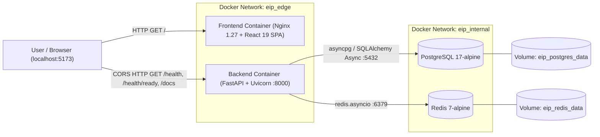
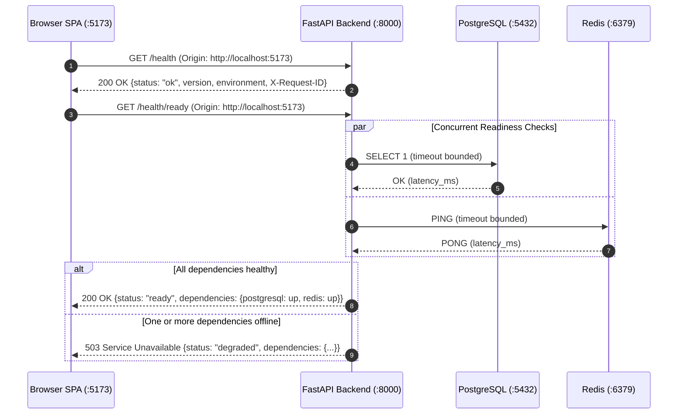
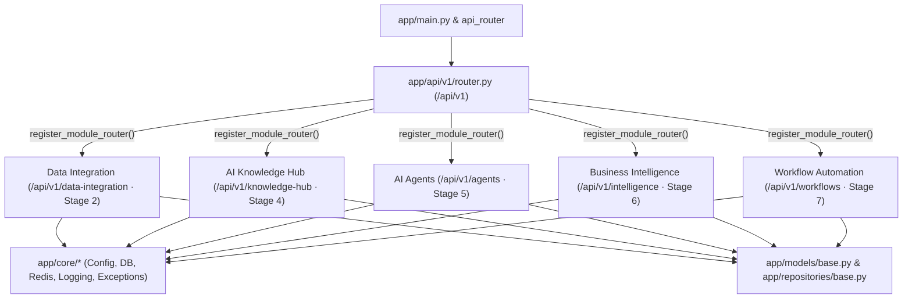

# System Architecture Overview

> **Stage:** 2 — Data Engineering & Integration (`v0.2.0`)

## 1. Architectural Vision

The **Enterprise Intelligence Platform** follows a **Modular Monolith** architecture in Stage 1. Rather than introducing distributed microservices, message brokers, or orchestration overhead prematurely, the platform consolidates application capabilities behind strict internal module boundaries while separating infrastructure responsibilities across containerized services.

At Stage 1, the system establishes:
- A clean **FastAPI** backend with centralized configuration, structured logging, database/cache managers, global error sanitization, and health/readiness probes.
- A **React + TypeScript + Vite** frontend shell that communicates cleanly with the backend API and visualizes real-time service and backing-dependency availability.
- A reproducible **Docker Compose** stack running PostgreSQL, Redis, the FastAPI backend, and an Nginx-served frontend bundle over segmented Docker networks.



---

## 2. Component Responsibilities

### 2.1 Frontend (`frontend/`)
- **`src/config/env.ts`**: Typed reader and normalizer for `VITE_API_BASE_URL`, `VITE_APP_NAME`, and `VITE_HEALTH_POLL_INTERVAL_MS`.
- **`src/services/httpClient.ts` & `healthService.ts`**: Centralized `fetch` HTTP client with `AbortController` timeouts and structured handling of both `200 OK` and `503 Service Unavailable` readiness payloads.
- **`src/hooks/useBackendHealth.ts`**: Lifecycle-safe React hook polling liveness and readiness probes cleanly on mount, interval, and manual verification.
- **`src/layouts/MainLayout.tsx`**: Enterprise top bar, live header API connectivity badge, OpenAPI docs shortcut, and footer.
- **`src/pages/PlatformOverviewPage.tsx` & `src/components/*`**: Presentation shell, real-time connectivity panel (Backend API, PostgreSQL latency/status, Redis latency/status), and informational catalog of planned platform modules.

### 2.2 Backend (`backend/app/`)
- **`core/config.py`**: Pydantic `BaseSettings` reading `.env` / environment variables, parsing comma-separated or JSON `CORS_ORIGINS`, validating `LOG_LEVEL`, and exposing credential-safe target strings (`safe_database_target`, `safe_redis_target`).
- **`core/logging.py`**: UTC ISO-8601 formatter injecting `X-Request-ID` correlation tokens via Python `ContextVar` across application and Uvicorn loggers.
- **`core/exceptions.py`**: `AppError` hierarchy (`ServiceUnavailableError`, `ConfigurationError`) and FastAPI global handlers returning sanitized `ErrorResponse` JSON envelopes without leaking connection strings or stack traces.
- **`core/database.py`**: `DatabaseManager` managing SQLAlchemy `AsyncEngine` (`pool_pre_ping=True`, `asyncpg`), `async_sessionmaker[AsyncSession]`, `get_db_session` dependency, and bounded-timeout `SELECT 1` readiness probes.
- **`core/redis.py`**: `RedisManager` managing `redis.asyncio.Redis`, `get_redis_client` dependency, and bounded-timeout `PING` readiness probes.
- **`models/base.py` & `repositories/base.py`**: Shared SQLAlchemy `DeclarativeBase` (with deterministic index/constraint naming conventions), `TimestampMixin`, and generic `BaseRepository[ModelT]` contract prepared for Stage 2 domain models.
- **`modules/__init__.py` & `api/v1/router.py`**: Architectural registry (`ModuleDescriptor`, `PLANNED_MODULES`, `register_module_router`) and empty `/api/v1` extension boundary.
- **`services/health.py` & `api/routes/health.py`**: `GET /health` liveness probe and `GET /health/ready` concurrent dependency readiness probe.
- **`main.py`**: `create_app()` factory wiring FastAPI OpenAPI metadata, lifespan startup/shutdown cleanup, CORS middleware, `X-Request-ID` middleware, exception handlers, and root router.

### 2.3 Stateful & Edge Infrastructure
- **PostgreSQL 17 (`eip-postgres`)**: Primary relational database initialized with `pgcrypto` via `infrastructure/docker/postgres/init.sql` and persisted via named volume `eip_postgres_data`.
- **Redis 7 (`eip-redis`)**: In-memory store configured with AOF persistence (`--appendonly yes --save 60 1`) and named volume `eip_redis_data` for future caching and background task queues.
- **Nginx 1.27 (`eip-frontend`)**: Serves the compiled Vite production bundle with SPA routing (`try_files`), gzip compression, security headers, and `/nginx-health`.

---

## 3. Communication Flow



---

## 4. Directory Structure

```text
enterprise-intelligence-platform/
├── .github/
│   ├── ISSUE_TEMPLATE/
│   │   ├── bug_report.md
│   │   ├── config.yml
│   │   └── feature_request.md
│   └── PULL_REQUEST_TEMPLATE.md
├── backend/
│   ├── app/
│   │   ├── api/
│   │   │   ├── routes/
│   │   │   │   └── health.py
│   │   │   ├── v1/
│   │   │   │   └── router.py
│   │   │   └── router.py
│   │   ├── core/
│   │   │   ├── config.py
│   │   │   ├── database.py
│   │   │   ├── exceptions.py
│   │   │   ├── logging.py
│   │   │   └── redis.py
│   │   ├── models/
│   │   │   └── base.py
│   │   ├── modules/
│   │   │   └── __init__.py
│   │   ├── repositories/
│   │   │   └── base.py
│   │   ├── schemas/
│   │   │   ├── common.py
│   │   │   └── health.py
│   │   ├── services/
│   │   │   └── health.py
│   │   └── main.py
│   ├── tests/
│   │   ├── conftest.py
│   │   ├── test_app_startup.py
│   │   └── test_health.py
│   ├── .dockerignore
│   ├── Dockerfile
│   ├── pyproject.toml
│   ├── requirements-dev.txt
│   └── requirements.txt
├── docs/
│   ├── architecture/
│   │   └── overview.md
│   ├── decisions/
│   │   ├── ADR-001-modular-monolith-architecture.md
│   │   ├── ADR-002-fastapi-backend.md
│   │   ├── ADR-003-postgresql-primary-database.md
│   │   ├── ADR-004-redis-cache-and-queue-infrastructure.md
│   │   ├── ADR-005-react-typescript-vite-frontend.md
│   │   ├── ADR-006-docker-compose-local-infrastructure.md
│   │   └── README.md
│   └── development/
│       ├── git-workflow.md
│       └── setup-and-run.md
├── frontend/
│   ├── public/
│   │   └── favicon.svg
│   ├── src/
│   │   ├── __tests__/
│   │   │   ├── App.test.tsx
│   │   │   ├── healthService.test.ts
│   │   │   └── setup.ts
│   │   ├── components/
│   │   │   ├── ConnectionStatusPanel/
│   │   │   ├── ModuleArchitectureCard/
│   │   │   └── StatusBadge/
│   │   ├── config/
│   │   │   └── env.ts
│   │   ├── hooks/
│   │   │   └── useBackendHealth.ts
│   │   ├── layouts/
│   │   │   └── MainLayout.tsx
│   │   ├── pages/
│   │   │   └── PlatformOverviewPage.tsx
│   │   ├── services/
│   │   │   ├── healthService.ts
│   │   │   └── httpClient.ts
│   │   ├── types/
│   │   │   ├── api.ts
│   │   │   └── health.ts
│   │   ├── App.tsx
│   │   ├── index.css
│   │   └── main.tsx
│   ├── .dockerignore
│   ├── .gitignore
│   ├── .prettierignore
│   ├── .prettierrc
│   ├── Dockerfile
│   ├── eslint.config.js
│   ├── index.html
│   ├── package.json
│   ├── tsconfig.app.json
│   ├── tsconfig.json
│   └── tsconfig.node.json
├── infrastructure/
│   └── docker/
│       ├── nginx/
│       │   └── default.conf
│       └── postgres/
│           └── init.sql
├── scripts/
│   ├── verify-stack.ps1
│   └── verify-stack.sh
├── .editorconfig
├── .env.example
├── .gitattributes
├── .gitignore
├── docker-compose.yml
└── README.md
```

---

## 5. Persistence & Configuration Strategy

### Persistence
- **Persistence Layer**: `app/models/base.py` provides the shared `Base` metadata and naming conventions; Stage 2 introduces Alembic (`backend/alembic/`) managing `data_sources`, `import_jobs`, and `imported_records` (hybrid relational + `JSONB` with GIN indexing).
- **Data Integration Module (`app/modules/data_integration/`)**: Implements extensible file extractors (`CsvExtractor`, `XlsxExtractor`, `JsonExtractor`, `ExtractorRegistry`), the `ETLPipeline` (column normalization, whitespace/null cleanup, type inference, explicit row rejection, duplicate detection), weighted quality scoring (`quality.py`), async repositories, `DataIntegrationService`, and `/api/v1` REST routes.
- **Data Management UI (`frontend/src/pages/dataManagement/`)**: Adds Overview, Import Data (with preview, Excel sheet selection, validation report, and confirm/cancel workflow), Data Sources, and Data Explorer (search, date range, dynamic field filter, pagination, and raw traceability modal).
- **Redis 7** persists append-only logs and snapshots in the named Docker volume `eip_redis_data` (`/data`) via `--appendonly yes --save 60 1`.
- Network segmentation isolates `postgres` and `redis` inside `eip_internal`, exposing them only to `backend` (plus optional mapped host ports for local debugging) while keeping `frontend` on `eip_edge`.

### Configuration & Secret Handling
- `.env.example` documents all configurable parameters using non-sensitive local placeholders.
- `.env` is strictly excluded via `.gitignore` and `.dockerignore`.
- Backend reads configuration through `app.core.config.Settings` (`pydantic-settings`). Secrets (`postgres_password`, `redis_password`, `database_url`) are never printed in startup logs or serialized in `ErrorResponse`.
- Frontend receives only public non-secret configuration (`VITE_API_BASE_URL`, `VITE_APP_NAME`, `VITE_HEALTH_POLL_INTERVAL_MS`) via Vite environment variables.

---

## 6. Technology Stack Rationale

| Layer | Technology | Pinned Version | Architectural Justification |
|---|---|---|---|
| **Backend API** | Python + FastAPI + Uvicorn | `3.12` / `0.165.0` / `0.54.0` | Async I/O performance, automatic OpenAPI docs, strong Python ecosystem for AI/ML/Data in Stages 2–7 |
| **Validation & Settings** | Pydantic + pydantic-settings | `2.14.4` / `2.16.3` | Strict runtime schema validation, typed `.env` loading, consistent serialization |
| **Persistence Layer** | SQLAlchemy (Async) + asyncpg + PostgreSQL | `2.1.9` / `0.32.0` / `17-alpine` | Mature relational ACID store, cross-platform async driver on Windows & Linux, extensible for `pgvector` in Stage 4 |
| **Cache & Queue Base** | Redis + redis-py (`redis.asyncio`) | `7-alpine` / `8.1.0` | Sub-millisecond key/value access, pub/sub, and future task queue backing |
| **Frontend SPA** | React + TypeScript + Vite | `19.3.1` / `5.9.3` / `8.3.8` | Strict static typing, fast HMR/builds, clean component boundaries for future enterprise UIs |
| **Quality Tooling** | Ruff, Mypy, Pytest, ESLint, Prettier, Vitest | `0.17.5`, `2.4.1`, `9.2.0`, `10.15.0`, `3.10.1`, `5.1.1` | Fast, uniform formatting, strict static typing, and automated test verification |
| **Local Runtime** | Docker Compose + Nginx | `v5.5.1` / `1.27-alpine` | Reproducible one-command environment across Windows Docker Desktop and Linux |

---

## 7. Incorporating Future Modules (Stages 2–7)

Each upcoming capability plugs into the backend as a self-contained domain module without rewriting `app/core/*` or `app/main.py`:



To onboard a new module in Stages 2–7:
1. Create a domain package (e.g., `backend/app/modules/<module_name>/`) containing its `router.py`, `schemas.py`, `services.py`, `models.py` (inheriting `app.models.base.Base`), and `repository.py` (inheriting `app.repositories.base.BaseRepository`).
2. Register its `APIRouter` against `v1_router` using `app.modules.register_module_router()` with the matching `ModuleDescriptor`.
3. On the frontend, add feature views under `frontend/src/pages/` and API clients under `frontend/src/services/`, reusing `requestJson` from `src/services/httpClient.ts`.
